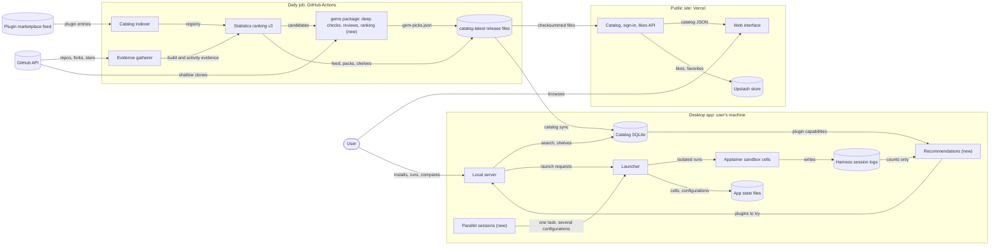

# Architecture

How the pieces fit once the plan in [PLAN.md](PLAN.md) is built. Items marked "new" do not exist on `main` yet.

## Components

| Component | Responsibility | Tech |
|---|---|---|
| Catalog indexer | Collect every public plugin and fork into one registry | Python, `scripts/index_registry.py`, `dsh_forge/marketplace.py`, `dsh_forge/registry.py` |
| Evidence gatherer | Measure how each promising project is built and maintained | Python, `dsh_forge/enrichment.py`, GitHub GraphQL |
| Statistics ranking v3 | Find projects with fewer stars than their build quality predicts; build packs and shelves | Python, `dsh_forge/discovery.py` |
| `gems` package (new) | Read the code of top candidates, combine checks and review verdicts into final picks, and score itself | Python, own CLI and tests, file contract only |
| Release files | The published catalog, feed and gem picks | GitHub release `catalog-latest` |
| Public site | Browse the catalog; sign in, like and favourite | Static `web/`, Vercel functions in `api/`, Upstash |
| Local server | Serve the same interface locally and expose launcher routes | Python, `scripts/serve.py` |
| Launcher | Find harness versions, install plugins and forks, start and stop cells, saved configurations | Python, `dsh_forge/launcher.py`, `dsh_forge/configurations.py` |
| Sandbox cells | Run community code isolated from the host | Apptainer, `dsh_forge/sandbox.py` |
| Recommendations (new) | Turn local session history into plugins to try, using counts only | Python, `dsh_forge/sessions.py`, `dsh_forge/recommendations.py` |
| Parallel sessions (new) | Run one task across several saved configurations and show results side by side | Python, `dsh_forge/comparisons.py`, tab deck in `web/launcher.js` |

## Data flow: one hidden gem, end to end

1. The daily job indexes the marketplace feed and the fork network into the registry.
2. The evidence gatherer measures up to 3,000 promising repositories.
3. The statistics ranking scores every project and hands its top candidates to the `gems` package.
4. `gems` shallow-clones each candidate at a pinned commit, runs automatic checks, and joins any saved review verdict for that commit.
5. `gems` ranks the candidates and writes `gem-picks.json`; the job publishes it with the catalog.
6. The public site and the desktop app read the picks file and show the "Hidden gems" shelf. If the file is missing they fall back to the statistics ranking.
7. On the desktop, the recommender prefers reviewed gems when it suggests plugins for what the user has been doing.
